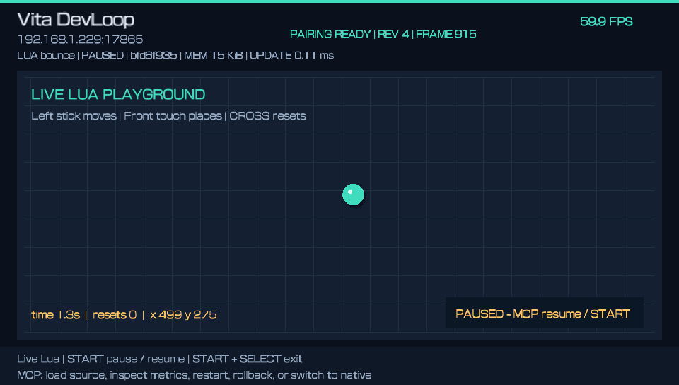

# PS Vita MCP

**Resident 0.1.7 is running on the Vita with its exact build verified.** The
current PC keeper passed a 90-second hold at one-minute standby with eight
renewals, confirmed release and operator-confirmed normal sleep afterward.
It also supports one guarded renewal-status GET retry. Its controlled hardware
test stopped safely before renewal when the fresh read also timed out. Broad transport
reliability and a complete current-build native development cycle remain open.
Rollbacks are retained. [Current results and limits](docs/RESIDENT-TRANSPORT.md).

The source catalog contains **42 tools**. A registered Resident subset passed
status, diagnostics and begin/renew/end after the previous PC restart. The new
keeper still needs a PC MCP restart before in-process jobs use it.
[CI run 38456106601](https://github.com/LeiterConsulting/ps-vita-mcp/actions/runs/38456106601)
passed all 33 host groups at code commit `2a32d08`, with all 34 required artifact
files independently size/hash-verified. This later documentation-only checkpoint
preserves that PC and native code; CI ran on the named code commit.

**Develop and inspect PlayStation Vita homebrew through MCP on real hardware.**

PS Vita MCP connects a desktop MCP client to a modded Vita. Its PC bridges combine live Lua editing with background status, verified file transfer, screen readback and bounded input. The repository contains the PC and Vita source, build scripts, examples and tests needed to reproduce this developer preview.

**Start here: [modded Vita → functional MCP](docs/GETTING-STARTED.md).** The guide covers prerequisites, building, pairing, manual installation, runtime activation, MCP registration, acceptance and recovery after reboot.



*Original DevLoop 01.02 framebuffer capture. [Gallery and provenance](docs/SCREENSHOTS.md).*

**Companion pairing:** Individual inspection credentials require physical
six-digit approval. Native code display and graceful challenge timeout passed;
successful individual credential confirmation remains pending.
[Pairing contract and device gates](docs/PAIRING.md).

## Status as of October 13 2026

**Current source:** The keeper can retry one eligible preflight GET timeout
during an owned renewal. It preserves the original revision, owner, conservative
TTL and fixed session deadline, and checks cancellation and expiry again after
connecting before POST bytes are sent. POSTs are never replayed. Direct status,
begin/end and native effect freshness checks remain strict.

All **92 focused client tests** passed: 58 lease, eight deadline and 26 transport
tests. Current host checks also passed 20 actual stdio checks, 16 file-MCP checks,
41 native-lifecycle PC tests, six probe smoke cases and six Windows TCP-info
tests. The named code commit also passed the 33-group CI run above.

On the exact installed 0.1.7, current PC source passed **90 seconds at one-minute
standby**, with eight renewals and confirmed end at revision 41. After 75 quiet
seconds, the operator confirmed normal automatic sleep before touching the
Vita. No timeout occurred, so that hold did not exercise the new retry path.
The controlled localhost harness passed. On hardware, the injected timeout
triggered one fresh GET, but the upstream read also timed out. No renewal POST
was sent; begin/end were the only two POSTs and cleanup confirmed end at
revision 43. Later unchecked/checked Wi-Fi power-saving comparisons stopped on
their read-only baselines with zero POSTs. The comparison is inconclusive, and
the operator restored the original checked setting. Recovery remains
unqualified despite passing host CI.

Lease coverage is per job: the command wrapper protects one host command, and
native execution starts its keeper after local preparation and initial status.
Planning, builds and Lua sessions do not share one automatic work-session lease.
A continuous session still needs explicit borrowing from one outer lease owner.
[Current coverage](docs/RESIDENT-KEEP-AWAKE.md#what-is-protected-automatically).

Earlier holds failed on preflight GET timeouts; their receipts are retained.
The PC deadline helper now applies the remaining five-second budget before
connect, send and each raw read, correcting an observed 5.63-second receive.
Native queued replies do not prove PC receipt, and the intermittent delivery
cause remains unknown. Current-build physical normal boot, physical TTL-expiry
sleep, full suspension and native-cycle qualification remain open. Native plugin
bytes are unchanged by these PC changes.
[Reusable probes](docs/RESIDENT-TRANSPORT.md#public-pc-probes) and
[dated qualification](docs/resident-transport-validation.json) are public;
raw receipts and iPhone implementation remain private.

**Historical 0.1.6 checks:** Resident 0.1.6 passed normal boot, the fresh 40-tool
MCP catalog and status/begin/renew/end checks. Bounded hardware passes cover an
isolated 120-second hold at one-minute standby, renewal during a verified slow
4 KiB transfer, native 30-second expiry after PC keeper loss, and one controlled
accepted-renewal reply drop reconciled without replay. A separate 90-second hold
ended cleanly and the operator confirmed normal automatic sleep afterward. All 41 PC client tests,
41 native-lifecycle host tests and the actual C integration test passed.

**Historical 0.1.6 Wi-Fi interruption:** The PC keeper stopped without replay.
After the operator manually reconnected Wi-Fi, both services responded on the
same build/instance.
The old lease was inactive at revision 66, ownership cleared and tick count 559
stable. Its retained reason was `listener_lost`; the first cancellation cause and
exact timing remain unknown. Separate fresh stdio checks exposed all 40 tools
and passed lease status/begin/renew/end.

**Remaining blockers:** Intermittent HTTP timeouts still interrupt production
freshness checks. A launch-only probe passed self-test and acknowledged exit,
with later absence confirmed, but its original result remains unconfirmed.
Current-build installation/redeployment and an uninterrupted keeper-protected
native cycle are unqualified; the earlier install rejection's exact cause is
unknown. Physical sleep after TTL expiry, full suspension and lease cancellation,
automatic Wi-Fi reassociation and repeated Wi-Fi recovery remain unqualified.
Power-button/display sleep and wake worked while the keeper continued renewing;
that observation does not establish full suspension. One-minute standby was
restored for those 0.1.6 trials, and automatic sleep after explicit end passed
separately. Earlier October 13 probes used 30-minute standby. An earlier
one-minute hold failed; current source later passed the bounded
one-minute hold and explicit-release sleep. TTL sleep and cancellation during full suspension remain
unqualified under 0.1.7.
[Detailed trials and pending gates](docs/RESIDENT-KEEP-AWAKE.md#interim-hardware-results)
and [dated validation record](docs/resident-keep-awake-validation.json).

**App-making workflow:** [`make-vita-app`](skills/make-vita-app/SKILL.md) provides
planning, port assessment, Lua project generation and a separate native
application-module wrapper for the single owned development slot. Its helper
checks scripts through the real shared Lua engine, builds source-bound native
prototypes and generates fresh MCP arguments. All 30 host groups passed. Two
native app builds passed registered-MCP install/launch/self-test/exit cycles,
including a changed-speed source iteration and read-only reconciliation. Routine
FTP, Starter, reboot and manual installation were unnecessary after waking the
Vita. Standalone title deployment and visual/physical acceptance remain separate.
[Install, commands and evidence](docs/MAKE-VITA-APP.md).

**Native lifecycle baseline:** Corrected Resident 0.1.5 previously passed five
fixed-Lab install → launch → evaluate → graceful exit cycles across two builds,
plus same-build journal durability after a normal reboot without replay.
Those results are historical and do not qualify installation on current 0.1.7.
Three PC tools provide exact-package preview, journaled execution and GET-only
reconciliation for the owned `VMCP00001` development slot.
[Architecture, ownership limits and qualification](docs/NATIVE-LIFECYCLE.md).

**Boot helper recovery:** Experimental Autostart and the isolated boot diagnostic
were withdrawn after boot hangs. The pre-experiment configuration was restored,
normal boot was confirmed and both helpers remain disabled. Their root cause is
unknown. [Dated recovery and candidate evidence](docs/autonomous-candidate-validation.json).

**Lua iteration:** An already open, paused DevLoop 01.04 supports bounded
Control-free script sessions: prepare exact runtime identity, evaluate hashed
candidates and restore the original scene. Default restoration, explicit best
candidate retention and guarded cleanup passed on hardware. Retained ranking and
journal failures and the separate capture/input/sleep gates are documented in
[the script-session record](docs/script-session-validation.json).

Earlier [baseline](docs/BASELINE.md), [Control qualification](docs/QUALIFICATION.md),
[Resident inventory](docs/resident-launch-validation.json),
[managed-file checks](docs/managed-files-validation.json) and
[pairing gates](docs/PAIRING-DEVICE-TESTS.md) retain their own version-scoped
records. A fresh build does not inherit another package's acceptance. This is a
source developer preview; no final binary release is certified.

| Component | Role | Source / recorded runtime |
| --- | --- | --- |
| Vita DevLoop | Foreground Lua edit/run/observe/recover; ten MCP tools | 01.04 installed; exact runtime identity, live Lua reload/recovery and normal exit passed. Capture mapping, synthetic input and sleep/reopen remain open. |
| [Vita Resident](docs/RESIDENT.md) | Boot-loaded status, verified package inbox and managed inspection and bounded keep-awake leases and transport diagnostics; thirteen source tools | 0.1.7 exact running build and post-restart registered subset verified. Current PC source passed one 90-second hold at one-minute standby and normal sleep after release. Controlled renewal recovery, broad transport reliability and native redeployment remain unqualified; earlier failed holds are retained. Earlier lease/native results are historical; rollbacks retained |
| [Vita Control](docs/CONTROL.md) | Background screen, managed files, app commands and bounded synthetic input; thirteen tools | 0.3.4 pairing candidate installed, ABI 2; earlier manual startup passed, automatic worker/network startup failed; recovery did not reactivate it |
| [Vita Workbench](workbench/README.md) | Lua iteration, native lifecycle candidate, runtime preparation, input trials, metrics, staging and file recovery; sixteen tools | Developer preview; native lifecycle, script readiness and verified input readiness have separate qualification |
| [Launch broker candidate](resident/launch_broker/README.md) | Durable fixed-title launch protocol and PC client | 0.1.4 identity/clock continuity passed with the broker disabled; earlier 0.1.3 PID correlation is historical; storage/reboot and launch-policy gates pending |
| [Native lifecycle candidate](docs/NATIVE-LIFECYCLE.md) | Verified owned package installation, fixed-title launch, cooperative exit and PC iteration | Corrected Resident 0.1.5 boot verified; five native Lab cycles across two builds passed; same-build normal-reboot journal durability passed without replay; original unknown promotion receipt retained without replay; accepted DevLoop installation preserved |
| Control Starter | Explicit activation after normal boot, then exits | 01.06 pairing candidate installed, title `CHRS00011`; 01.04 retained as the older rollback |
| [Automatic startup experiment](resident/autostart/README.md) | Deferred loading of the exact matched Control pair after LiveArea readiness | 0.1.0 withdrawn from routine use; disabled historical boot passed, armed service failed; source retained for offline diagnosis |
| [Boot resource diagnostic](resident/boot_diagnostic/README.md) | Isolated SDK mutex/thread probe without Control or network loads | 0.1.0 withdrawn after boot failure; resource trial not established, root cause unknown |
| [Control Inspector](docs/INSPECTOR.md) | Optional read-only app/Shell diagnostic | 01.03; not required for the baseline |

Resident, Control and Workbench source now share one **42-tool desktop MCP server**: thirteen Resident, thirteen Control and sixteen Workbench tools. DevLoop has its own ten-tool server. The computer speaks MCP over stdio; the Vita runs authenticated HTTP services. Restart the PC MCP connection after updating its source to discover new tools. The three native lifecycle tools require Resident 0.1.5 and the dedicated lab qualification; corrected 0.1.5 passed five native Lab cycles and a GET-only normal-reboot durability check, while the original unknown attempt remains retained without replay; retained 0.1.4 does not implement that namespace. The existing manual Starter path keeps Control available after Starter exits, until normal reboot. DevLoop must be running for Lua operations.

After the PC Resident MCP was restarted, the actual registered catalog exposed all **36 tools**. Direct Resident status, an unexecuted native preview and GET-only reconciliation of the completed post-reboot job passed. These read-only checks are separate from the five mutating cycles run through fresh stdio sessions. [Qualification details](docs/NATIVE-LIFECYCLE.md#registered-mcp-readiness-pass).

The earlier October 12 registered desktop MCP check exposed all 33 tools available at that point. Direct registered-tool calls passed exact installed Resident 0.1.4 status, managed attempt listing, file size/SHA-256 and a complete 4096-byte read with independent full-file hash verification. DevLoop retained the same paused runtime identity and revision while frames advanced. Earlier fresh stdio checks remain separate evidence.

`vita_workbench_prepare_script_session` observes healthy paused DevLoop 01.04 twice with an exact native build pin; `vita_workbench_script_session` uses the returned PID, run and revision to iterate scenes without Control. Neither provides screen capture, input, a remote scene lease or keep-awake. The separate Control-backed `vita_workbench_prepare_devloop` can submit one journaled launch and inspect an uncertain result without repeating it. Synthetic trials require an exact DevLoop build pin, fresh Control captures matching native `CHRS00003` title/PID and stable run/build identity. Legacy 01.02/01.03 remains script-only. The installed 01.04 still needs capture mapping and input qualification once Control is available. [Autonomous workflow and startup gates](docs/AUTONOMOUS-DEVLOOP.md).

Recorded checks include managed file publish/readback/copy/hash-guarded deletion, file manager/LiveArea/DevLoop screen readback, DevLoop launch/quit, five input channels observed by app telemetry, input expiry without a PC release, stale-target refusal and focus cancellation. Public build results remain separate from those original device identities. No prebuilt public binary release is available yet.

The PC upload repair preserves the same attempt ID in the Workbench journal, Resident transfer and readbacks. Local MCP tests cover recovery after a lost reply without repeating the upload. Starter 01.06 also passed physical code display and graceful timeout after the 01.05 display failure. Successful individual confirmation, saved reconnect, phone permissions and persistence still need device acceptance; the PC pairing form was stopped before a fresh request.

## Public PC code and private iPhone app

The **iPhone Companion app remains private**. Its app source, Swift packages, Xcode projects, signing material, builds and handoff archives are excluded from this repository. The project's public source license does not distribute or license that private implementation.

[PC setup and workflows](docs/PC-SIDE.md) cover the public desktop tools. [The iPhone Companion guide](docs/IPHONE-COMPANION.md) documents pairing, inspection permissions and recovery without app source. The public pairing protocol and Vita implementation remain here so desktop clients can interoperate. `.gitignore` and CI enforce the file boundary; credentials and raw device evidence also stay local.

[Plan to remove routine FTP dependence](docs/FILE-SERVICE-ROADMAP.md): extend
Resident HTTP file management, then qualify native installation and updates
separately.

## Build and set up

Use Windows, PowerShell 7, Python 3.13, Git and Docker Desktop with Linux containers:

```powershell
git clone https://github.com/LeiterConsulting/ps-vita-mcp.git
cd ps-vita-mcp
.\Setup-DevLoop.ps1
.\Build-McpBaseline.ps1
```

The build runs host C, actual MCP stdio and local FTP fixtures, then validates the ARM modules and VPKs. It never contacts the Vita. Outputs are under `dist/devloop/`, `dist/resident/`, `dist/control/` and `dist/workbench/`; reports bind exact sources and artifact hashes.

Follow [the complete setup guide](docs/GETTING-STARTED.md) to install and pair the components. The accepted DevLoop and general app installation path, boot testing and recovery remain manual. The separate [native lifecycle candidate](docs/NATIVE-LIFECYCLE.md) passed five automated cycles across two builds of the owned Lifecycle Lab; that qualification does not extend to DevLoop or arbitrary apps. The existing path loads Control through Starter after a confirmed normal boot and inspected native state. The separate [startup experiment](resident/autostart/README.md) and boot diagnostic are retained as default-disabled source experiments for offline diagnosis; their current candidates are withdrawn from routine use. Do not activate or re-arm them. The earlier direct Control boot configuration hung and remains excluded.

After DevLoop pairing, an example edit can run without rebuilding the native app:

```powershell
.\.venv-devloop\Scripts\python.exe bridge\run_script.py experiments\bounce.lua --resume --capture
```

For a bounded two-candidate session through actual stdio MCP, first open the installed, paired DevLoop 01.04 and leave it paused. Pin its installed build, then run:

```powershell
$devloop = Get-Content .\dist\devloop\build-report.json -Raw | ConvertFrom-Json
.\.venv-devloop\Scripts\python.exe tools\prove_script_session.py $devloop.nativeIdentity.buildId
```

This explicit live command loads and measures two movement scenes, ranks them and restores the original scene paused. It does not launch DevLoop, use Control or keep the Vita awake. Use a report matching the installed native build. [Workbench workflows](workbench/README.md) describe custom hashed manifests, metric checks and optional retention. Control-backed profiles additionally support captured input trials; those require verified native foreground identity. See the [release checklist](docs/RELEASE-CHECKLIST.md) for separate hardware gates.

The optional [PC pairing check](docs/PC-SIDE.md#test-native-pairing-from-the-pc) opens a loopback form for immediate manual code entry. Its self-tests run without a Vita; live use requires exact installed build pins and an operator at Starter. It does not start automatically with MCP.

The [Lua interface](SCRIPTING.md) covers drawing, input observations, metrics and recovery. The [input proof](experiments/mcp_input_proof.lua) observes synthetic Control delivery and neutral return after lease expiry.

## How it fits together


[Architecture](docs/ARCHITECTURE.md) explains revision guards, capture and lifecycle. [Control tools](docs/CONTROL.md) document arguments, limits, the loopback preview and paired-module identity. [DevLoop tools](docs/TOOLS.md) describe its separate foreground interface.

## Current limits

- Control captures on-demand still images: preview up to 240×136, detail up to 480×272. Warm samples were about 126–324 ms; multi-second outliers occurred. Sustained video and latency guarantees remain open.
- Input leases last 16–1000 ms and cancel on focus change. One synthetic contact per panel is supported. Stick offsets add to physical centers; readback and calibration matter. PS/power/volume are excluded.
- Control files are confined to fresh revisions under `ux0:data/vita-control/workspace`; transfers are at most 8 MiB. System and installed-app writes are outside this API.
- DevLoop Lua source is at most 16 KiB, with a 1 MiB allocation budget per VM and callback instruction budgets. Drawing is limited to 256 buffered commands. Script state is in RAM; assets/audio/file APIs are future work.
- Script sessions evaluate at most eight candidates with 120 seconds aggregate warmup/measurement, excluding requests and restoration. They use the local operation lock and revision/hash guards, without a remote scene lease. Lost mutation replies stop iteration without replay; another remote client's request race remains possible. Without qualified Control, these jobs cannot keep the screen awake, change brightness, capture the foreground or inject input.
- Accepted-path native installation, startup confirmation and reboot recovery require an operator. The fixed Lifecycle Lab path passed five cycles across two builds and same-build normal-reboot journal durability without replay. Extension to DevLoop, automatic Control bootstrap and interrupted-native/power-cut recovery remain unqualified. Both current boot experiments are withdrawn from routine use after boot failures. Physical touch restoration, sleep/wake, automatic Wi-Fi reassociation and repeated interruption recovery and additional device combinations need qualification. Pairing uses unencrypted HTTP on a trusted LAN.
- Script readiness does not prove the foreground input target. Legacy DevLoop lacks native title/PID mapping and cannot run synthetic Workbench profiles under the current safety checks.

These are current implementation limits. A heartbeat or accepted API call alone does not establish a working autonomous session. [New-device acceptance](docs/BASELINE.md#acceptance-on-a-new-device) is the gate for remaining DevLoop work.

## Documentation and support

| Need | Reference |
| --- | --- |
| Full setup from an already modded Vita | [Getting started](docs/GETTING-STARTED.md) |
| PC bridges, configuration, testing and recovery | [PC side](docs/PC-SIDE.md) |
| Autonomous preparation, foreground identity and startup gates | [Autonomous DevLoop](docs/AUTONOMOUS-DEVLOOP.md) |
| Private iPhone app workflow and public pairing contract | [iPhone Companion](docs/IPHONE-COMPANION.md), [pairing protocol](docs/PAIRING.md) |
| Staging identity and acceptance | [Functional baseline](docs/BASELINE.md), [machine-readable record](docs/functional-mcp-baseline.json) |
| Recovery, failed startup, stale markers, endpoint errors | [Troubleshooting](docs/TROUBLESHOOTING.md) |
| Test scope and release checks | [Validation](docs/VALIDATION.md), [current qualification](docs/QUALIFICATION.md), [release checklist](docs/RELEASE-CHECKLIST.md) |
| Follow-on development | [Roadmap](ROADMAP.md) |
| Reproduction or contribution | [Contributing](CONTRIBUTING.md), [issue form](https://github.com/LeiterConsulting/ps-vita-mcp/issues/new/choose) |

Original project code and documentation use [MIT](LICENSE), selected for easy reuse. Dependencies keep their existing licenses; [third-party notices](THIRD_PARTY_NOTICES.md) include the adapted input-hook license. Complete linked-library notices are a prerequisite to public binary distribution. This is an independent homebrew project.

## References

- [Model Context Protocol](https://modelcontextprotocol.io/)
- [VitaSDK](https://vitasdk.org/)
- [libvita2d](https://github.com/xerpi/libvita2d)
- [Lua](https://www.lua.org/)
