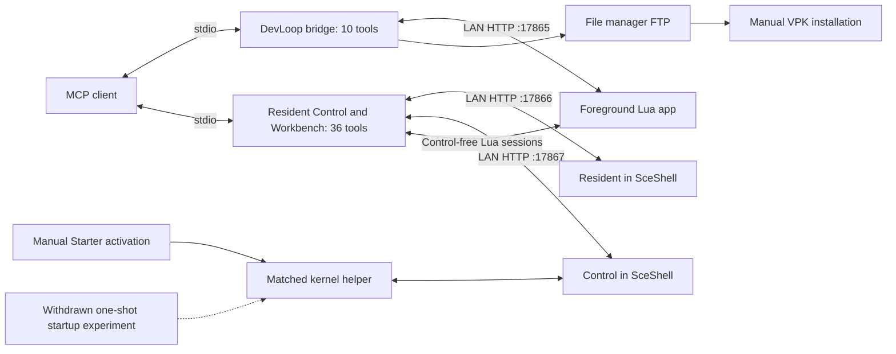

# PS Vita MCP

**Develop and inspect PlayStation Vita homebrew through MCP on real hardware.**

PS Vita MCP connects a desktop MCP client to a modded Vita. Its PC bridges combine live Lua editing with background status, verified file transfer, screen readback and bounded input. The repository contains the PC and Vita source, build scripts, examples and tests needed to reproduce this developer preview.

**Start here: [modded Vita → functional MCP](docs/GETTING-STARTED.md).** The guide covers prerequisites, building, pairing, manual installation, runtime activation, MCP registration, acceptance and recovery after reboot.


*Original DevLoop 01.02 framebuffer capture. [Gallery and provenance](docs/SCREENSHOTS.md).*

**Pairing candidate:** [six-digit Companion pairing](docs/PAIRING.md) adds individual inspection credentials, physical approval and durable 90-day inactivity expiry. The earlier Resident 0.1.2 / Control 0.3.4 / Starter 01.06 pairing trial passed normal startup, physical code display and graceful challenge timeout. The corrected Resident 0.1.5 is now running after a confirmed normal boot, with 0.1.4, 0.1.3 and 0.1.2 retained for rollback. Four fixed-Lab native cycles across two builds passed; journal durability after reboot, individual credential confirmation and the wider device gates remain open. [Historical candidate checks and remaining gates](docs/PAIRING-DEVICE-TESTS.md).

## Status as of October 12 2026

**Native lifecycle candidate:** Resident 0.1.5 adds administrator-only staging,
native package promotion and a fixed-title launch adapter for the new Vita
Lifecycle Lab (`VMCP00001`). Three new PC tools preview an exact package,
execute a journaled install → launch → evaluate → graceful exit cycle, and
inspect an interrupted job without replaying mutations. Repeated cycles can
redeploy the owned package. [Architecture, limits and qualification](docs/NATIVE-LIFECYCLE.md).
The corrected Resident 0.1.5 is now boot-loaded after a confirmed normal boot
and exact device-binary verification. Its fresh native instance is unblocked,
reports the installer ready and leaves Promoter unloaded. Four fixed-Lab native
install → launch → evaluate → graceful exit cycles across two builds passed,
including repeated reinstall and a changed-build redeploy, with successful
read-only reconciliation. Same-build journal durability after reboot remains
pending. The corrected full 27-group host suite passed.
The earlier build's single `0x80871012` promotion outcome remains unknown and
retained without replay. [Exact builds, incident and next hardware gates](docs/NATIVE-LIFECYCLE.md#october-12-native-promotion-incident).
Accepted 0.1.4 is retained for rollback; DevLoop 01.04 remains installed. The legacy DevLoop launch broker stays disabled.
[Exact candidate hashes and validation](docs/native-lifecycle-validation.json)
separate the 27-group host pass, ARM packaging and verified staging from the
remaining hardware checks.

The automatic-startup and isolated boot-diagnostic candidates are withdrawn from routine use after October 12 boot failures. The diagnostic activation hung at the initial product-manual screen and shut down; boot trouble persisted after restoring the pre-diagnostic configuration, which still included Autostart. Plugin-bypass boot reached the file manager. The pre-Autostart configuration was then restored with two exact readbacks and both experiments disabled, preserving pairing, logs and attempt guards. The operator confirmed a normal boot without plugin bypass; fresh read-only checks verified the recovered configuration, disable markers and exact Resident identity through the registered MCP. Recovery is verified. The root cause is unknown; neither experiment should be armed again under the current qualification.

The October 11 native builds, 17-group host pass and normal disabled Autostart boot remain scoped historical results. The armed Autostart trial then reached native service submission, but Control's work-power worker failed and its endpoint stayed unavailable. DevLoop 01.04 separately passed installation, exact runtime identity, a 55-step live Lua reload/recovery proof and normal START+SELECT exit. Control capture mapping, synthetic input and sleep/reopen remain open. [Dated candidate evidence](docs/autonomous-candidate-validation.json) records these distinct outcomes. PC preparation and the manual Starter path remain in source; recovery did not load Control or activate another boot candidate.

The October 12 PC source adds bounded **Control-free script sessions** for an already open, paused DevLoop 01.04. Prepare its exact native identity, supply up to eight hashed Lua candidates, measure and rank their metrics, then restore the original scene paused. The corrected two-candidate live MCP proof passed: movement rates 60 and 120, faster candidate selected, exact runtime identity retained and original scene/native world restored paused. A separate `retain_best` proof left the winner in a verified fresh paused VM; guarded cleanup then restored the original scene. The first proof's cumulative-distance ranking failed because HTTP delays produced unequal execution times; that failure is retained. Script sessions intentionally edit the running app's in-memory scene without changing installed native files or boot configuration.

Resident 0.1.3 was activated earlier and passed a user-confirmed normal boot. Read-only checks matched the proposed configuration and exact plugin, preserved the 0.1.2 rollback and saved administrator pairing, and found no configuration override or rearmed boot experiment. Three broker samples retained one native instance with advancing time and `enabled`, `configured_enabled` and `blocked` all false. Initial inventory resolved the running file manager to an AppId/PID/title. With DevLoop open and paused, eight further observations retained its exact build/PID/run and revision, advanced frames and matched inventory's `CHRS00003` PID every time. Resident retained its instance and advanced its clock; foreground, protected-UI and submission flags stayed false. Fresh stdio MCP status and 4 KiB probes with two complete readbacks passed with both the file manager and DevLoop open, without restarting Resident. A further bounded two-candidate Lua regression measured rates 60/120, selected the faster candidate and restored the original native world paused with exact runtime identity; Lua finished inactive with the last VM retained. Native storage durability across reboot and phone credential confirmation remain pending. Native launching is disabled and unconditionally refused. [Historical 0.1.3 qualification](docs/resident-launch-validation.json).

The earlier October 12 host suite passed all **22 groups**, including real Lua under sanitizers and actual MCP/CLI transport. A third live session rejected bad syntax, recovered from a controlled runtime fault, continued to a healthy candidate and restored the original scene. [Script-session evidence](docs/script-session-validation.json) records exact source hashes, corrected live passes, retained failures and remaining limits.

**Historical Resident 0.1.4 managed inbox inspection** passed a user-confirmed normal boot plus 12 initial read-only checks. Fresh stdio MCP exposed all 33 tools; native checks verified root/fixture listing, complete hashes and reads of a 4096-byte probe, a 97-byte retained part and an empty retained part, a middle range and EOF, and malformed/access/range refusals. Resident retained one disabled, unblocked broker instance with advancing time. Exact plugin/configuration readbacks preserved both rollback plugins, saved administrator pairing and experiment disable markers. A separate DevLoop coexistence check passed eight stable-identity samples with advancing frames, a new 4096-byte upload, two complete publication readbacks and exact managed stat/readback, without Control or Lua changes. Repeated boot, storage durability and phone credential confirmation remain pending. Native installation and launching remain separate. All 23 host groups and the ARM build passed independently. [Contract](docs/MANAGED-FILES.md), [dated validation](docs/managed-files-validation.json).

The October 3 baseline is retained in [the historical record](docs/BASELINE.md). [October 4 qualification](docs/QUALIFICATION.md) records the earlier Control 0.3.3 tests. [Pairing gates](docs/PAIRING-DEVICE-TESTS.md) retain the earlier 0.1.2 / 0.3.4 / 01.06 candidate and its partial results. A fresh build does not inherit another package's acceptance. This is a source developer preview; no final binary release is certified.

| Component | Role | Source / recorded runtime |
| --- | --- | --- |
| Vita DevLoop | Foreground Lua edit/run/observe/recover; ten MCP tools | 01.04 installed; exact runtime identity, live Lua reload/recovery and normal exit passed. Capture mapping, synthetic input and sleep/reopen remain open. |
| [Vita Resident](docs/RESIDENT.md) | Boot-loaded status, verified package inbox and managed inspection; seven tools | Corrected 0.1.5 boot-loaded and exact binary verified; installer ready and unblocked; four native Lab cycles across two builds passed; same-build journal durability after reboot pending. Accepted 0.1.4/.3/.2 rollback retained |
| [Vita Control](docs/CONTROL.md) | Background screen, managed files, app commands and bounded synthetic input; thirteen tools | 0.3.4 pairing candidate installed, ABI 2; earlier manual startup passed, automatic worker/network startup failed; recovery did not reactivate it |
| [Vita Workbench](workbench/README.md) | Lua iteration, native lifecycle candidate, runtime preparation, input trials, metrics, staging and file recovery; sixteen tools | Developer preview; native lifecycle, script readiness and verified input readiness have separate qualification |
| [Launch broker candidate](resident/launch_broker/README.md) | Durable fixed-title launch protocol and PC client | 0.1.4 identity/clock continuity passed with the broker disabled; earlier 0.1.3 PID correlation is historical; storage/reboot and launch-policy gates pending |
| [Native lifecycle candidate](docs/NATIVE-LIFECYCLE.md) | Verified owned package installation, fixed-title launch, cooperative exit and PC iteration | Corrected Resident 0.1.5 boot verified; four native Lab cycles across two builds passed; same-build journal durability after reboot pending; original unknown promotion receipt retained without replay; accepted DevLoop installation preserved |
| Control Starter | Explicit activation after normal boot, then exits | 01.06 pairing candidate installed, title `CHRS00011`; 01.04 retained as the older rollback |
| [Automatic startup experiment](resident/autostart/README.md) | Deferred loading of the exact matched Control pair after LiveArea readiness | 0.1.0 withdrawn from routine use; disabled historical boot passed, armed service failed; source retained for offline diagnosis |
| [Boot resource diagnostic](resident/boot_diagnostic/README.md) | Isolated SDK mutex/thread probe without Control or network loads | 0.1.0 withdrawn after boot failure; resource trial not established, root cause unknown |
| [Control Inspector](docs/INSPECTOR.md) | Optional read-only app/Shell diagnostic | 01.03; not required for the baseline |

Resident, Control and Workbench source now share one **36-tool desktop MCP server**: seven Resident, thirteen Control and sixteen Workbench tools. DevLoop has its own ten-tool server. The computer speaks MCP over stdio; the Vita runs authenticated HTTP services. Restart the PC MCP connection after updating its source to discover new tools. The three native lifecycle tools require Resident 0.1.5 and the dedicated lab qualification; corrected 0.1.5 is ready for its next hardware qualification, while the original unknown attempt remains retained without replay; retained 0.1.4 does not implement that namespace. The existing manual Starter path keeps Control available after Starter exits, until normal reboot. DevLoop must be running for Lua operations.

The earlier October 12 registered desktop MCP check exposed all 33 tools available at that point. Direct registered-tool calls passed exact installed Resident 0.1.4 status, managed attempt listing, file size/SHA-256 and a complete 4096-byte read with independent full-file hash verification. DevLoop retained the same paused runtime identity and revision while frames advanced. Earlier fresh stdio checks remain separate evidence.

`vita_workbench_prepare_script_session` observes healthy paused DevLoop 01.04 twice with an exact native build pin; `vita_workbench_script_session` uses the returned PID, run and revision to iterate scenes without Control. Neither provides screen capture, input, a remote scene lease or keep-awake. The separate Control-backed `vita_workbench_prepare_devloop` can submit one journaled launch and inspect an uncertain result without repeating it. Synthetic trials require an exact DevLoop build pin, fresh Control captures matching native `CHRS00003` title/PID and stable run/build identity. Legacy 01.02/01.03 remains script-only. The installed 01.04 still needs capture mapping and input qualification once Control is available. [Autonomous workflow and startup gates](docs/AUTONOMOUS-DEVLOOP.md).

Recorded checks include managed file publish/readback/copy/hash-guarded deletion, file manager/LiveArea/DevLoop screen readback, DevLoop launch/quit, five input channels observed by app telemetry, input expiry without a PC release, stale-target refusal and focus cancellation. Public build results remain separate from those original device identities. No prebuilt public binary release is available yet.

The PC upload repair preserves the same attempt ID in the Workbench journal, Resident transfer and readbacks. Local MCP tests cover recovery after a lost reply without repeating the upload. Starter 01.06 also passed physical code display and graceful timeout after the 01.05 display failure. Successful individual confirmation, saved reconnect, phone permissions and persistence still need device acceptance; the PC pairing form was stopped before a fresh request.

## Public PC code and private iPhone app

The **iPhone Companion app remains private**. Its app source, Swift packages, Xcode projects, signing material, builds and handoff archives are excluded from this repository. The project's public source license does not distribute or license that private implementation.

[PC setup and workflows](docs/PC-SIDE.md) cover the public desktop tools. [The iPhone Companion guide](docs/IPHONE-COMPANION.md) documents pairing, inspection permissions and recovery without app source. The public pairing protocol and Vita implementation remain here so desktop clients can interoperate. `.gitignore` and CI enforce the file boundary; credentials and raw device evidence also stay local.

[Plan to remove routine FTP dependence](docs/FILE-SERVICE-ROADMAP.md): extend
Resident HTTP file management, then qualify native installation and updates
separately.

## Build and set up

Use Windows, PowerShell 7, Python 3.13, Git and Docker Desktop with Linux containers:

```powershell
git clone https://github.com/LeiterConsulting/ps-vita-mcp.git
cd ps-vita-mcp
.\Setup-DevLoop.ps1
.\Build-McpBaseline.ps1
```

The build runs host C, actual MCP stdio and local FTP fixtures, then validates the ARM modules and VPKs. It never contacts the Vita. Outputs are under `dist/devloop/`, `dist/resident/`, `dist/control/` and `dist/workbench/`; reports bind exact sources and artifact hashes.

Follow [the complete setup guide](docs/GETTING-STARTED.md) to install and pair the components. The accepted DevLoop and general app installation path, boot testing and recovery remain manual. The separate [native lifecycle candidate](docs/NATIVE-LIFECYCLE.md) passed four automated cycles across two builds of the owned Lifecycle Lab; that qualification does not extend to DevLoop or arbitrary apps. The existing path loads Control through Starter after a confirmed normal boot and inspected native state. The separate [startup experiment](resident/autostart/README.md) and boot diagnostic are retained as default-disabled source experiments for offline diagnosis; their current candidates are withdrawn from routine use. Do not activate or re-arm them. The earlier direct Control boot configuration hung and remains excluded.

After DevLoop pairing, an example edit can run without rebuilding the native app:

```powershell
.\.venv-devloop\Scripts\python.exe bridge\run_script.py experiments\bounce.lua --resume --capture
```

For a bounded two-candidate session through actual stdio MCP, first open the installed, paired DevLoop 01.04 and leave it paused. Pin its installed build, then run:

```powershell
$devloop = Get-Content .\dist\devloop\build-report.json -Raw | ConvertFrom-Json
.\.venv-devloop\Scripts\python.exe tools\prove_script_session.py $devloop.nativeIdentity.buildId
```

This explicit live command loads and measures two movement scenes, ranks them and restores the original scene paused. It does not launch DevLoop, use Control or keep the Vita awake. Use a report matching the installed native build. [Workbench workflows](workbench/README.md) describe custom hashed manifests, metric checks and optional retention. Control-backed profiles additionally support captured input trials; those require verified native foreground identity. See the [release checklist](docs/RELEASE-CHECKLIST.md) for separate hardware gates.

The optional [PC pairing check](docs/PC-SIDE.md#test-native-pairing-from-the-pc) opens a loopback form for immediate manual code entry. Its self-tests run without a Vita; live use requires exact installed build pins and an operator at Starter. It does not start automatically with MCP.

The [Lua interface](SCRIPTING.md) covers drawing, input observations, metrics and recovery. The [input proof](experiments/mcp_input_proof.lua) observes synthetic Control delivery and neutral return after lease expiry.

## How it fits together



[Architecture](docs/ARCHITECTURE.md) explains revision guards, capture and lifecycle. [Control tools](docs/CONTROL.md) document arguments, limits, the loopback preview and paired-module identity. [DevLoop tools](docs/TOOLS.md) describe its separate foreground interface.

## Current limits

- Control captures on-demand still images: preview up to 240×136, detail up to 480×272. Warm samples were about 126–324 ms; multi-second outliers occurred. Sustained video and latency guarantees remain open.
- Input leases last 16–1000 ms and cancel on focus change. One synthetic contact per panel is supported. Stick offsets add to physical centers; readback and calibration matter. PS/power/volume are excluded.
- Control files are confined to fresh revisions under `ux0:data/vita-control/workspace`; transfers are at most 8 MiB. System and installed-app writes are outside this API.
- DevLoop Lua source is at most 16 KiB, with a 1 MiB allocation budget per VM and callback instruction budgets. Drawing is limited to 256 buffered commands. Script state is in RAM; assets/audio/file APIs are future work.
- Script sessions evaluate at most eight candidates with 120 seconds aggregate warmup/measurement, excluding requests and restoration. They use the local operation lock and revision/hash guards, without a remote scene lease. Lost mutation replies stop iteration without replay; another remote client's request race remains possible. Without qualified Control, these jobs cannot keep the screen awake, change brightness, capture the foreground or inject input.
- Accepted-path native installation, startup confirmation and reboot recovery require an operator. The fixed Lifecycle Lab installation candidate still needs hardware qualification and extension to DevLoop. Both current boot experiments are withdrawn from routine use after boot failures; persistent startup and repeated-boot behavior are unqualified. Physical touch restoration, sleep/wake, independent Wi-Fi-loss recovery and additional device combinations need qualification. Pairing uses unencrypted HTTP on a trusted LAN.
- Script readiness does not prove the foreground input target. Legacy DevLoop lacks native title/PID mapping and cannot run synthetic Workbench profiles under the current safety checks.

These are current implementation limits. A heartbeat or accepted API call alone does not establish a working autonomous session. [New-device acceptance](docs/BASELINE.md#acceptance-on-a-new-device) is the gate for remaining DevLoop work.

## Documentation and support

| Need | Reference |
| --- | --- |
| Full setup from an already modded Vita | [Getting started](docs/GETTING-STARTED.md) |
| PC bridges, configuration, testing and recovery | [PC side](docs/PC-SIDE.md) |
| Autonomous preparation, foreground identity and startup gates | [Autonomous DevLoop](docs/AUTONOMOUS-DEVLOOP.md) |
| Private iPhone app workflow and public pairing contract | [iPhone Companion](docs/IPHONE-COMPANION.md), [pairing protocol](docs/PAIRING.md) |
| Staging identity and acceptance | [Functional baseline](docs/BASELINE.md), [machine-readable record](docs/functional-mcp-baseline.json) |
| Recovery, failed startup, stale markers, endpoint errors | [Troubleshooting](docs/TROUBLESHOOTING.md) |
| Test scope and release checks | [Validation](docs/VALIDATION.md), [current qualification](docs/QUALIFICATION.md), [release checklist](docs/RELEASE-CHECKLIST.md) |
| Follow-on development | [Roadmap](ROADMAP.md) |
| Reproduction or contribution | [Contributing](CONTRIBUTING.md), [issue form](https://github.com/LeiterConsulting/ps-vita-mcp/issues/new/choose) |

Original project code and documentation use [MIT](LICENSE), selected for easy reuse. Dependencies keep their existing licenses; [third-party notices](THIRD_PARTY_NOTICES.md) include the adapted input-hook license. Complete linked-library notices are a prerequisite to public binary distribution. This is an independent homebrew project.

## References

- [Model Context Protocol](https://modelcontextprotocol.io/)
- [VitaSDK](https://vitasdk.org/)
- [libvita2d](https://github.com/xerpi/libvita2d)
- [Lua](https://www.lua.org/)
